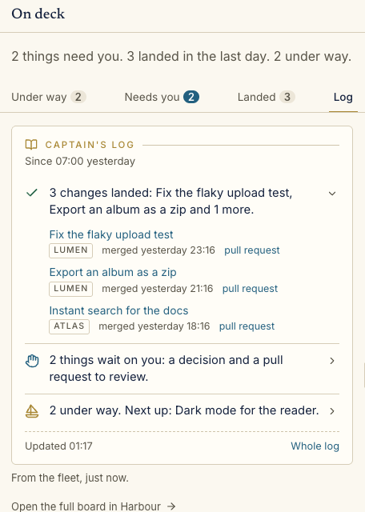

# Captain's log

A [Wheelhouse](https://github.com/chrisjowen/wheelhouse) plugin: a short digest on the home page's rail, in three plain lines.

- **What landed** since you were last here (or since your morning start), with links to each task and its pull request.
- **What waits on you**: decisions, pull requests to review, and approved pull requests to merge.
- **What is under way and next**: how much the crew has on, what is with Firstmate or other reviewers, and the next task in the backlog.

Each line opens to its list. **Whole log** leads to a **Captain's log** page in the left-hand menu: the same three lines, then what landed on each of the last seven days.



<sub>Made-up projects.</sub>

## Install

```sh
wheelhouse plugin install chrisjowen/captains-log-wheelhouse
```

Or use **Install plugin** in **Settings → Plugins** with `chrisjowen/captains-log-wheelhouse`. Install asks for the settings below; Enter takes each default.

## Turn it on

The plugin is off until you turn it on. In **Settings → Plugins**, open **Captain's log** and switch it on for every project, or for the projects you want. The digest covers only the projects it is on for. The **Log** tab then shows on the home page's rail, after Under way, Needs you and Landed, and **Captain's log** shows in the left-hand menu.

## Settings

Change these on the plugin's page in **Settings → Plugins**. They apply without a restart.

| Setting                       | Default               | What it does                                                                                    |
| ----------------------------- | --------------------- | ----------------------------------------------------------------------------------------------- |
| **What the digest covers**    | Since I was last here | Or **Since my morning start each day**.                                                         |
| **Morning start**             | 07:00                 | A 24-hour time. Used for the morning window, and before this browser has a last visit to go by. |
| **Look back at most (hours)** | 72                    | After a long time away, the digest covers no more than this. At most 168 (a week).              |

The settings are stored as `window` (`last-visit` or `morning`), `morningStart` and `lookbackHours` under `plugins.captains-log.settings` in Wheelhouse's `plugins.json`. A value the plugin cannot use falls back to its default, and the card says so.

**"Since you were last here"** is this browser's own record, kept in its local storage while the log is on screen. Coming back after more than half an hour away starts a new visit, so the digest covers what happened while you were gone. A different browser, or one with its storage cleared, starts from the morning start until it has a visit of its own.

The **Log** tab shows a count of what landed since the morning start when the digest covers the morning, and no count when it covers your last visit, since only the browser knows when that was.

Only "what landed" depends on this window. What waits on you and what is under way are always as they are now.

## What it reads

Only the fleet Wheelhouse hands every plugin (tasks and projects, which Wheelhouse reads from Firstmate's records: the backlog, status, fleet ledger and pull request state) and its own settings. It runs no commands, reads no files and writes nothing. Like every plugin, it cannot message Firstmate or ring the ship's bell.

It sorts tasks the way Wheelhouse's own rail does, so its counts agree with the Under way, Needs you and Landed tabs.

## Develop

```sh
npm ci
npm run lint   # Prettier and ESLint
npm test       # Vitest: the digest's words and times, the server entry, the manifest and the elements
```

The plugin has no build step and no runtime dependencies. Wheelhouse imports the files as they are:

- `.wheelhouse-plugin/plugin.json`: the manifest. `test/fixtures/plugin.schema.json` is a copy of the [plugin SDK's schema](https://raw.githubusercontent.com/chrisjowen/wheelhouse/main/packages/plugin-sdk/plugin.schema.json), which the tests check it against.
- `wheelhouse/server/index.js`: the `digest` provider, a fleet-wide read that sorts the tasks, and the two contributions (the `home.card` tab and the `nav.page` page).
- `wheelhouse/ui/index.js`: the `<captains-log-digest>` and `<captains-log-page>` elements.
- `wheelhouse/ui/digest.js`: the settings, the window and the sentences, shared by both.

## Possible follow-ups

- Post the morning digest to Discord through Wheelhouse's messaging gateway. Plugins cannot send messages today, so this would need Wheelhouse to do the sending.

## Licence

MIT
